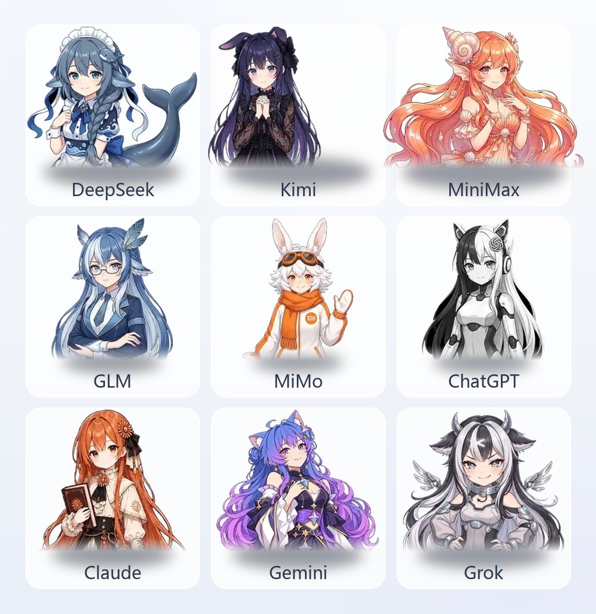

# Balance Widget (nine-balance-widget)

<picture>
  <source media="(prefers-color-scheme: dark)" srcset="assets/grid-dark.jpg">
  
</picture>

A permanent balance widget in the bottom-right corner of the Hermes desktop app: a cartoon mascot sticks to the corner of the screen, and **one click pops a comic-style glass bubble** showing nine providers' balance / subscription quota / usage today — DeepSeek · MiniMax · Zhipu GLM · Kimi · MiMo · ChatGPT · Claude · Gemini · Grok. **The mascot swaps automatically to match the model you are using** (case-insensitive keyword match on the model name); probe-tier providers estimate spend from local token usage; DeepSeek / GLM / MiMo **switch prices automatically** on their official time-of-day schedules.

A standard Hermes disk plugin: a single `plugin.js` dropped into the plugin folder — no session tokens, no outbound reporting, keys stored locally only.

> The fetch-template structure and field semantics are ported from [DeepSeek-Balance-Whale-Widget](https://github.com/MeteorNOX/DeepSeek-Balance-Whale-Widget) (MIT © MeteorNOX) and rewritten into Hermes plugin form for the nine-provider list; the pricing table follows the same conventions as upstream.

## Nine-provider fetch tiers (13 fetch sources; subscriptions and pay-as-you-go listed separately)

| Tier | Sources | Providers | What is shown |
|---|---|---|---|
| Pay-as-you-go · true balance | 3 | DeepSeek, Kimi (CN), Kimi (INTL) | Balance figure (¥ / $), used today |
| Subscription quota | 5 | MiniMax (CN / INTL), Zhipu GLM (CN / INTL), Kimi Coding | Remaining % over the 5-hour / weekly window |
| Probe (no official balance API) | 5 | MiMo, ChatGPT, Claude, Gemini, Grok | Key validity + today's estimate (token-priced) |

For the same provider, **subscriptions and pay-as-you-go are separate rows**: Kimi = payg (CN) + Kimi Coding subscription + payg (INTL), three sources; MiniMax / Zhipu = CN + INTL, two sources. Every source has its own key, its own display, and its own connectivity test.

> Providers that simply have no "query balance with a key" API are a fact of life, not a defect — the widget reports probe status and estimated spend as they are and **never fakes numbers**. Admin-only spend APIs (OpenAI / Anthropic admin keys, MiniMax admin key) and each provider's missing payg balance endpoints are noted on the matching card in the settings page.

## Features

### Fetching and display

- 💰 **Three honest states**: true balance shows the number, subscription shows the remaining window percentage, probe shows ✓ + today's estimate
- 📊 **Used today**: accumulated from locally observed balance drops (top-ups don't reset it; it resets across days); true-balance providers only
- 💬 **Cost per turn**: subscription session state, settled on `cost_usd` deltas; falls back to tokens × unit price when the host reports no cost
- 🔄 **Auto-refresh every 60 seconds** plus a manual **Refresh** button inside the bubble
- 🧠 **Mascot follows the model**: hitting a model-name keyword swaps both the mascot and the fetch target (`XIAOMI/MIMO-V2.6-PRO` → MiMo); on no match it falls back to the primary provider chosen in settings, and can be switched off in one click

### Mascot and interaction

- 🧸 **Box-hugging mascot**: each of the nine images is cropped to its own alpha bbox (width 160–288, per mascot), with zero padding left, right, and on top — clicks land on the mascot body, the transparent wings let clicks pass through to the page below, and the bubble tail sits right against the top of its head
- 💬 **Comic bubble**: liquid-glass card, automatically white glass by day and deep glass at night (follows `--theme-background-seed`), flips to the other side automatically when it would overflow
- 🎈 **Squishy press**: compresses on press, springs back on release, with a press sound effect
- 🖱️ **Drag + edge snapping**: position is persisted
- 🎚️ **Size control**: 60%–160% slider, applies live while dragging, scales in place without shifting position
- 🗨️ **Per-mascot random lines**: each provider has a pool of ≥5 joke lines (drawn from how the Chinese community teases each model), **re-rolled on every open** (never repeating the previous one) and rotating every 8 seconds while open

### Pricing

- 🧮 **Today's estimate (token-priced)**: for providers with no balance API, today's spend = local session input / output tokens × price per million tokens, with cache hits billed at the hit price
- ⚙️ **Custom unit price per provider**: four fields — input / output / cache hit / cache write (blank = fall back to the built-in list price; `0` = that item is free)
- ⏰ **Automatic time-of-day price switching** (DeepSeek / GLM / MiMo): the configured price is the daytime price; hitting an off-peak window applies a multiplier automatically (see the pricing table below); **windows are decided in Beijing time**, independent of your local timezone
- 🧾 **No price bleed across windows**: today's tokens are split into two buckets by the window at the moment they are accounted for, so usage in different windows is settled at each window's own price

### Alerts and sound

- 🔔 **Balance alert**: a notice + alert tone when the balance drops below a threshold (fires once per crossing, auto-resets when it recovers)
- 🎵 **Task-finished sound**: plays when a turn completes (synthesized live with WebAudio, no external assets)

## Installation (Hermes desktop)

1. Download the latest **`plugin.js`** from [Releases](../../releases)
2. Open Hermes's **Skills & Tools → Plugins** page and click **"Open plugin folder"** (the folder icon) — it opens the real plugin root directory on this machine; **don't guess the path by hand** (defaults differ per platform)
3. Create a folder named `nine-balance-widget` under the plugin root and put `plugin.js` inside it
4. Go back to the plugins page and click **Refresh** ↻

**Success signal**: a toast appears — `💰 Balance Widget plugin loaded · Settings entry: sidebar "Balance Widget"` — a "Balance Widget" entry shows up in the plugin list, and the mascot widget appears in the bottom-right corner.


> ⚠️ Editing a **single file** inside the plugin folder **does not trigger an auto-reload** (the watcher only listens for directory-level events) — click **Refresh** manually every time.

## Setup guide

### 1. Fill in API keys (required)

Open the settings page — any of three ways: bottom-left of the **sidebar** ("Balance Widget") / **command palette** `Ctrl+Shift+K` → "Balance Widget: Open Settings" / go straight to the route `/balance-widget`.

The settings page has one card per provider, and **one row per fetch source** inside the card (subscriptions and pay-as-you-go on separate rows):

| Field | Description |
|---|---|
| Source title + tier badge | "Subscription · CN", "Pay-as-you-go · INTL", etc.; decides the data shape of that row |
| Key input | Password field, **stored only in plugin-local storage (localStorage), never leaves this machine**; the first source reuses the old storage key, so upgrades need zero migration |
| Test connectivity | With a key filled in, sends one real query to the provider's official API and shows the balance / window / probe result |

Where to get each provider's key:

| Source | Console |
|---|---|
| DeepSeek pay-as-you-go | platform.deepseek.com → API Keys |
| MiniMax subscription (CN) | platform.minimaxi.com → API keys (valid only for Coding Plan subscription accounts) |
| MiniMax subscription (INTL) | the platform behind api.minimax.io, separate account and key |
| Zhipu GLM subscription (CN) | open.bigmodel.cn → API Keys |
| Zhipu GLM subscription (INTL) | the z.ai platform, separate account and key |
| Kimi pay-as-you-go (CN) | platform.moonshot.cn → API Keys |
| Kimi Coding subscription | kimi.com/code console → a separate key (not interchangeable with the Moonshot API key) |
| Kimi pay-as-you-go (INTL) | the platform behind api.moonshot.ai, separate account and key |
| MiMo | token-plan endpoint (no balance API; the key is used for probing only) |
| ChatGPT / Claude / Gemini / Grok | each provider's official API console (none offers a balance API; the key is used for probing only) |

Sources you haven't configured show "Key not configured" and don't affect the display of the provider's other sources.

### 2. Widget controls (top of the settings page)

| Setting | Description |
|---|---|
| Show the corner widget | Master switch |
| Widget size | 60%–160% slider, applies live while dragging |
| Follow the current model to swap the mascot | Swaps the mascot and the fetch target by model-name keyword (case-insensitive); when off, it is pinned to the primary provider |
| Primary provider | Switch by clicking the 3×3 grid — with auto-swap on, this is the fallback when no keyword matches |
| Sounds (press / task finished / alert) | Master switch + volume |
| Random bubble lines | The small line at the bottom of the bubble |
| Balance alert + threshold | Notice + alert tone below the threshold (e.g. `5`); true-balance providers only |

### 3. Unit prices and time-of-day schedules (bottom of each provider card)

Four price inputs — input / output / cache hit / cache write (in the provider's own currency; **cache write has no host data source yet and is excluded from estimates**, the field is kept for configuration). Blank = use the built-in list price; `0` = that item is free. Below the price fields the card shows today's estimate, token usage, and the **window currently in effect**, live.

### 4. Day-to-day interaction

- **Click the mascot**: squishy press → glass bubble opens (click again or click outside to close)
- **Press and drag**: snaps near screen edges
- **"Refresh" in the bubble**: re-fetches immediately
- **Theme**: white glass by day / deep glass at night, follows automatically, no setting needed

## Pricing table (default list prices, per million tokens)

Amounts are in the **provider's currency**; time-of-day providers are written as "[daytime / peak] → [night / off-peak]". The table lives in `src/pricing.js` under `DEFAULT_PRICES` / `SCHEDULES` — when a provider changes prices, edit it there, or just override it in the settings page.

| Provider | Input | Output | Cache hit | Cache write | Time-of-day |
|---|---|---|---|---|---|
| DeepSeek (V4.1-Flash) | 2 → 1 | 8 → 4 | 0.04 → 0.02 | — | Xiaonan-Liang tier / Liangsheng tier ×0.5 |
| Zhipu GLM (5.3-Flash) | 0.8 → 0.4 | 2.8 → 1.4 | 0.23 → 0.115 | — | Zei tier / Yige tier ×0.5 |
| MiMo (V2.5) | 1 | 2 | 0.02 | — | bug tier / Leibusi tier ×0.8 |
| Kimi (K3, CN) | ¥20 | ¥100 | ¥2 | ¥20 | — |
| MiniMax (M2.7) | ¥7.2 | ¥36 | — | — | — |
| ChatGPT (GPT-5.6 Sol) | $4 | $20 | $0.40 | — | — |
| Claude (Sonnet 5) | $2 | $10 | $0.20 | $2.5 | — |
| Gemini (3.5 Flash) | $1.5 | $9 | $0.15 | — | — |
| Grok (4.6) | $2 | $6 | $0.50 | — | — |

**Time-of-day windows (all in Beijing time)**:

| Provider | Daytime / peak (full price) | Night / off-peak (discounted) |
|---|---|---|
| DeepSeek | Weekdays 9:00–12:00, 14:00–18:00 | Everything else + **all day at weekends**, ×0.5 |
| GLM | Weekdays 14:00–18:00 | Everything else, ×0.5 (Coding Plan credits cover 50%) |
| MiMo | 8:00–24:00 | 0:00–8:00, ×0.8 |

> List prices come from official docs / community verification as of 2026-10, each entry cited in the source; after a provider reprices, **just edit the unit price in the settings page** — no plugin update needed. DeepSeek already includes the 2026-08-17 peak/off-peak pricing and weekend off-peak rules.

## FAQ

- **Widget doesn't appear**: make sure `plugin.js` went into its own folder under the plugin root (not loose in the root), then click **Refresh** on the plugins page. Check whether the toast appeared — no toast means the plugin didn't load.
- **Edits to `plugin.js` don't take effect**: the plugin watcher only listens for directory-level events, so editing a single file requires a manual **Refresh**.
- **Clicking the mascot does nothing / misses**: the hit area is its tight bounding box — you have to land on the mascot itself; clicks on the transparent wings pass through to the page below (intentional, so nothing gets triggered by accident). When the mascot sits on the bottom edge of the screen, the bubble flips below.
- **Probe-tier balance shows "—"**: there is no official "query balance with a key" API, so "—" is not a bug; the headline number in that bubble is **today's estimate** (token-priced).
- **Today's estimate missing / shows "price not configured"**: a probe-tier provider needs local token usage records first (run a conversation with that provider's model) and an available input / output price (the built-in list price counts; the notice only appears when you've cleared it manually and no default remains).
- **"Used today" stays at ¥0**: it accumulates from observed balance drops, and the baseline starts **at the first successful fetch** — spend before that moment isn't in the window; a top-up never reduces it.
- **Time-of-day tier names make no sense**: the tier names are custom (DeepSeek's Xiaonan-Liang / Liangsheng tiers, and so on); see the pricing table above. The "current window" row in the bubble shows the live tier, and the estimate is already converted at that tier's price.
- **Where do keys get sent?**: stored only in plugin-local storage (localStorage); requests go only to the corresponding provider's official API; the plugin has no third-party reporting of any kind.
- **Cost per turn never appears**: a turn has to finish completely before it settles; when the host reports no `cost_usd` it falls back to tokens × unit price, which needs that provider's price to be available.

## Data & privacy

- Provider API keys are entered by the user on the settings page and **stored plugin-locally only; they never leave this machine**
- Network calls go **only to the providers' official APIs** for balance / quota / probe queries — **no third-party reporting of any kind**
- **No shell command execution, no resident background processes, no telemetry or usage reporting**; it reads no files outside its own plugin storage (it never touches `.env`, `auth.json`, or any other credential files)
- "Used today", "Today's estimate" and "Cost per turn" are all **local observational estimates** and may differ from provider billing (the host provides no cache-write detail, and so on)
- The repo ships a `.gitignore` that blocks `*.secret` / `.env`; this repository contains no local paths, usernames, keys, or environment identifiers

## Development & maintenance

```bash
python build.py        # assemble the single-file plugin.js (per-entry assert surgery + node --check gate; no output written if the gate fails)
node test/smoke.mjs    # smoke: nine-provider templates (13 sources) / three fetch states / model matching / per-mascot phrase pools / token pricing / time-of-day windows / registration structure
```

- Source layout: `src/providers.js` fetch templates, `src/balance.js` fetch executor (field paths like `a.b[0].c`), `src/pricing.js` pricing and schedules, `src/widget.js` the widget itself, `src/shell.js` settings page and registration; `build.py` assembles everything and injects the nine mascots as base64 into `MASCOTS`
- Asset pipeline (`tools/`): `compress_assets.py` compresses the originals → `cutout_rembg.py` cuts them out with semantic segmentation (rembg + alpha matting) → `diag_edge.py` checks the edges
- After editing sources, run `build.py` + `smoke.mjs`, then hit **Refresh** back on the plugins page

## Assets & copyright

- **The nine mascot images**: AI-generated for this project and hand-cut (`assets/transparent/*.webp` are the finished cutouts taking part in the build, `assets/*.jpg` are the raw generations kept for provenance only). The MiMo mascot follows Xiaomi's "Mitu" style — the rights to that character belong to **Xiaomi Corporation** and it is used here solely as a provider identifier; it will be replaced immediately if the rights holder objects.
- **Provider names and logos** (DeepSeek, MiniMax, Zhipu, Kimi, MiMo, ChatGPT, OpenAI, Claude, Anthropic, Gemini, Google, Grok, xAI) are trademarks of their respective owners; this project uses them only as product identifiers when describing where data comes from, with no affiliation or endorsement.
- **Sound effects**: all synthesized live with WebAudio; no third-party audio assets are used.

## Acknowledgements

- [DeepSeek-Balance-Whale-Widget](https://github.com/MeteorNOX/DeepSeek-Balance-Whale-Widget) (MIT © **MeteorNOX**): this project is a port of its fetch-template structure, balance / quota field semantics, and time-of-day pricing conventions — the original is a complete accounting widget for the DSH web UI, far richer than this plugin, and well worth a look.
- The Chinese community's teasing of each model is the source material for the nine mascots' phrase pools.

## License

[MIT](./LICENSE) — includes the upstream DeepSeek-Balance-Whale-Widget copyright notice (© MeteorNOX).
